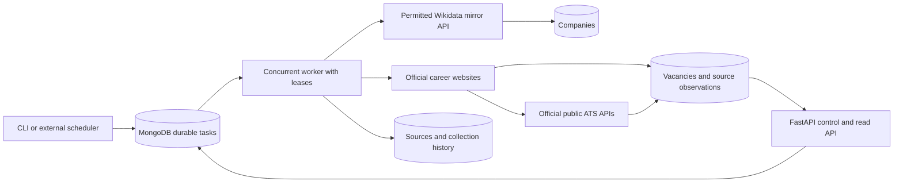

# Architecture and implementation plan

This is an executable Phase 1 foundation, not a claim of exhaustive market coverage.
No frontend, paid search, AI service, manually maintained company list, or driving-distance filter is used.

## Data flow

1. Seed durable discovery tasks for Limburg, Noord-Brabant, Gelderland, Utrecht, Noord-Holland, in that priority order.
2. Query public QLever Wikidata-mirror SPARQL for businesses whose headquarters lie within each province. Stable ordered offset pagination creates durable follow-up tasks. QLever uses its own public API policy; the official Wikidata endpoint remains blocked by robots. Broader business discovery deliberately avoids a technology-only industry taxonomy; technical relevance is determined from vacancies.
3. Upsert companies by website hostname; preserve geographic discovery provenance and Wikidata IDs.
4. Inspect official websites and career links. Detect supported public ATS boards and prefer their official read-only APIs. Follow career navigation and HTML pagination links; parse JSON-LD JobPosting, including @graph arrays.
5. Normalize and classify every collected job, retaining out-of-scope and uncertain records. Scope is English + relevant engineering/AI title + a resolved target province. No radius filter.
6. Upsert vacancies; record source observations and per-attempt history. Successful full ATS snapshots reconcile disappeared jobs. HTML snapshots do not close unseen jobs because a partial page is not authoritative.
7. Serve authenticated read/status APIs; a separate worker process drains durable tasks or watches continuously. A scheduler can enqueue a new cycle through the API or CLI.

MongoDB is both persistent queue and system of record. No in-process FastAPI background task owns a collection run. Workers can restart without losing progress. Atomic claims, renewable leases, owner-fenced completion, and idempotent writes provide at-least-once processing. Side effects may repeat after lease loss; MongoDB uniqueness and upserts limit duplication. This does not provide exactly-once execution.

HTTP uses TLS verification, public-address checks, manual redirect validation, robots checks, bounded retries, Retry-After handling, timeout, and per-host process-local throttling. Robots failures other than 404 fail closed. Login, CAPTCHA, denied robots rules and access restrictions are never bypassed. Contact identity must be configured before live use. Requests use inherited proxy/CA configuration. A deployment egress firewall is still necessary against DNS rebinding; URL validation alone cannot eliminate that risk.

## Database schema

Dates are UTC BSON dates. Hash IDs are deterministic SHA-256 strings unless stated otherwise.

| Collection | Important fields | Identity/indexes |
| --- | --- | --- |
| companies | name, domain, website, wikidata_ids[], discovery_provinces[], created_at, updated_at | _id=hash(domain); unique domain |
| sources | company_id, url, kind, last_attempt_at, last_success_at, job_count | _id=hash(company,url); unique(company_id,url) |
| vacancies | company_id, external_id, canonical_url, title, description, location, province[], language, skills[], seniority, relevant, in_scope, location_unresolved, classification_version, duplicate_group, source_ids[], active, first_seen_at, last_seen_at | _id=hash(company,url); unique(company_id,canonical_url); scope lookup index |
| tasks | kind, payload, priority, status, attempts, available_at, owner, lease_until, last_error, created_at, finished_at | deterministic cycle-specific ID; claim index(status,available_at,priority) |
| history | task_id, attempt, started_at, finished_at, result, error | BSON ObjectId; index(task_id,started_at desc) |
| observations | source_id, vacancy_id, seen_at, present | _id=hash(source,vacancy) |

Payload stores province/page offset for discovery, company/url/depth for crawling, and ATS kind/API URL for collection. Cycles allow refresh without resetting previous history. Reusing a cycle resumes instead of re-enqueuing completed work. Failed tasks are retained after the configured attempt limit. A new cycle retries discovery cleanly; inspect errors before restarting.

Canonical URLs remove fragments and marketing tracking parameters while retaining job-identity query parameters. Cross-source jobs sharing the same canonical URL merge. A duplicate_group groups normalized company/title/location for review; different URLs are preserved because two distinct openings can share a title and location.

## Supported source contracts

Greenhouse: public job board endpoint with content=true. Lever: full public postings array, without limit/skip. Ashby: public job-board API. Recruitee: public offers API. Each currently returns a full board without pagination parameters. Response schema errors fail the task; they must not produce an empty successful snapshot. Wikidata is explicitly paginated. HTML links preserve query pagination; exploration stops after four navigation edges. Unsupported ATS and JavaScript-only pages require additional adapters and are not bypassed with browser automation.

## Implementation milestones

1. **Implemented:** deterministic mocked integration from discovery through Mongo-compatible persistence and a repeat run; supported adapter contracts; robots and task fencing tests.
2. **Implemented:** FastAPI, durable worker, discovery pagination, normalization, classifiers, source observations, container configuration, setup documentation.
3. **Before claiming full initial discovery:** supplement sparse Wikidata headquarters data with a licensed search/directory provider and branch-office discovery. Add supported adapters for encountered systems (including Workday, SmartRecruiters, Teamtailor and Personio), sitemaps, and structured coverage reports for unsupported sources and crawl cutoffs. Search inputs must be generated from geography and role taxonomy rather than a company list.
4. **Before production launch:** replace the starter city dictionary with an official municipality/postcode gazetteer and evaluate language/role classification against labeled jobs. Add explicit Dutch-language requirements and remote eligibility fields, content-change history, source freshness alerts, distributed host limits, MongoDB schema validators, database migration tooling, dependency locks/scanning and scheduled backups. Validate large-run recovery and rate-limit behavior against provider sandboxes.

## Coverage and operational limits

Public data cannot establish that every technology company or all public vacancies have been found. Current discovery covers headquarters represented in Wikidata, not every office or company registry entry. Language identification is deterministic but probabilistic; short text is unknown. Province inference uses a starter city dictionary; ambiguous Utrecht locations and locations without a supported city need review. The company discovery province is never substituted for the actual job location. Sources failing robots checks, returning errors or requiring JavaScript remain incomplete. HTML crawling is bounded and may miss unlinked jobs. A completed queue only means all known tasks reached terminal states, not complete market coverage.

Per-host pacing is process-local; use one worker process for live runs until a distributed limiter is installed. Internal async concurrency is supported. MongoDB calls during extraction are synchronous and can block the event loop briefly; claim/finish/heartbeat use threads. API access is a simple shared key: deploy behind TLS with a gateway for user identity, request limits and audit logs. Do not expose local unauthenticated MongoDB. No automatic retention deletion is configured.

## Process topology

