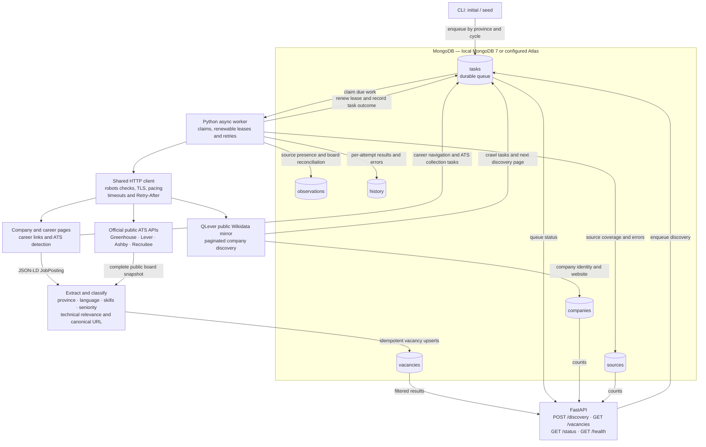

# VacHunter: current backend

This diagram shows the implemented Phase 1 backend. MongoDB runs locally in Docker Compose or can be configured to use Atlas; Atlas has not been validated. The API and worker are separate processes. No frontend is implemented.

Province priority: **Limburg → Noord-Brabant → Gelderland → Utrecht → Noord-Holland**. Vacancy scope is an English technical role with a resolved location in one of these provinces. There is no driving-distance filter. Out-of-scope and unresolved collected vacancies are retained.

The worker creates follow-up tasks as discovery and crawling progress. Reusing a cycle resumes existing work; a new cycle refreshes it. A successful complete ATS snapshot can mark missing vacancies inactive; failed collections and partial HTML snapshots do not close unseen jobs. Request pacing is process-local, so the current recommended live topology uses one worker process with internal concurrency.

The API requires `X-API-Key` except for `/health`. It reads vacancy results and operational counts, and enqueues discovery; collection runs in the worker. GitHub Actions runs pytest with MongoDB 7 on pushes and pull requests. A recurring scheduler and a frontend are future work.

Discovery currently depends on businesses and headquarters represented in Wikidata. Location classification uses a starter city dictionary. Unsupported ATS products and JavaScript-only pages remain coverage gaps. See [architecture and implementation plan](architecture.md) and [validation report](validation.md) for details.
